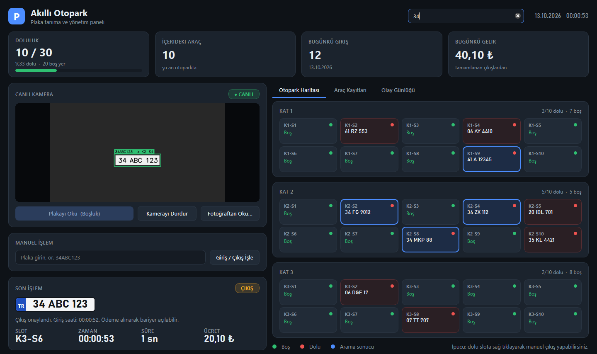
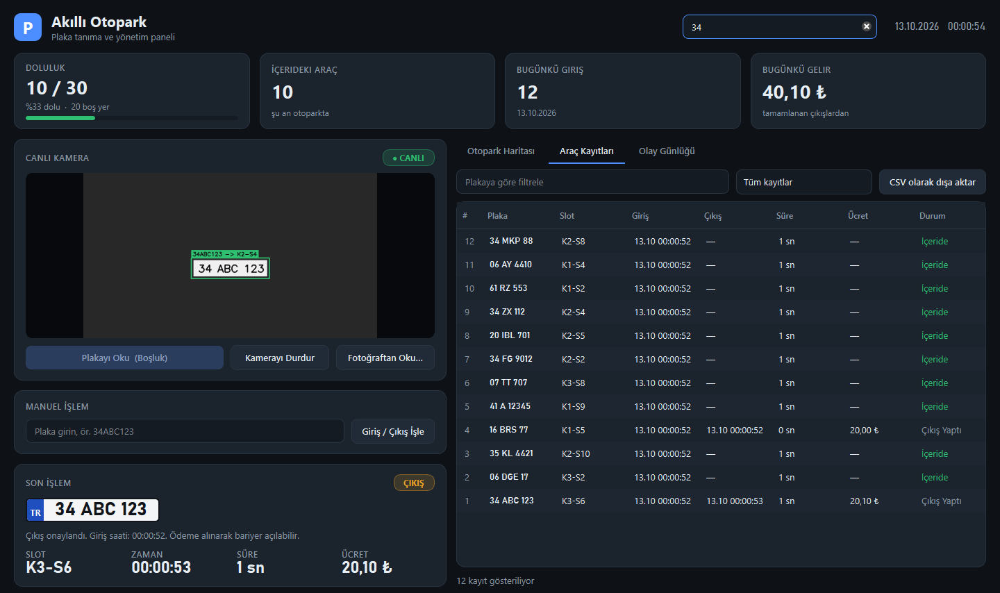

# 🅿️ Akıllı Otopark Sistemi

Kamera görüntüsünden **Türk plakalarını otomatik okuyan**, araç giriş/çıkışlarını kaydeden, araçlara boş park yeri atayan ve kalınan süreye göre **ücret hesaplayan** bir otopark yönetim sistemi.



## Özellikler

- **Plaka tanıma:** Roboflow üzerinde eğitilmiş bir YOLO modeli plakanın yerini bulur, EasyOCR plakayı okur.
- **Türk plakası doğrulama:** Okunan metin il kodu, harf ve rakam kurallarına göre denetlenir. `O/0`, `I/1`, `B/8` gibi OCR karışıklıkları otomatik düzeltilir.
- **Otomatik giriş/çıkış:** İçeride olmayan araç için giriş kaydı açılır ve rastgele boş bir slot atanır. Aynı araç tekrar okunduğunda çıkış yapılır ve ücret hesaplanır.
- **Masaüstü yönetim paneli (PyQt6):**
  - Canlı kamera görüntüsü, okunan plakanın üzerinde renkli çerçeve
  - 3 kat × 10 slotluk canlı otopark haritası
  - Doluluk, içerideki araç sayısı, günlük giriş ve gelir kartları
  - Plaka arama (eşleşen araçların slotları haritada vurgulanır)
  - Araç kayıtları tablosu, filtreleme ve CSV (Excel) olarak dışa aktarma
  - Fotoğraftan plaka okuma, elle plaka girişi, elle çıkış
- **Hatalı işlemlere karşı koruma:** Aynı plaka 10 saniye içinde tekrar okunursa yok sayılır. Otopark doluyken araç içeri alınmaz.



## Kullanılan teknolojiler

| Alan | Teknoloji |
|---|---|
| Plaka tespiti | Roboflow `inference`, YOLO modeli (`turkish-license-plate/8`) |
| Karakter okuma | EasyOCR |
| Görüntü işleme | OpenCV, NumPy |
| Arayüz | PyQt6 |
| Veritabanı | SQLite (WAL modu) |

## Kurulum

**Gereksinim:** Python 3.10 veya üstü

```bash
git clone https://github.com/KULLANICI_ADI/TermProject.git
cd TermProject
pip install -r requirements.txt
```

Roboflow API anahtarını ayarlayın: `.env.example` dosyasını `.env` adıyla kopyalayın ve anahtarınızı yazın.

```
ROBOFLOW_API_KEY=buraya_anahtarinizi_yazin
```

> `.env` dosyası `.gitignore`'da olduğu için GitHub'a gönderilmez.

## Kullanım

```bash
python otopark_arayuz.py
```

Veritabanı (`otopark.db`) ilk açılışta otomatik oluşturulur.

| Kısayol | İşlev |
|---|---|
| `Boşluk` | Kameradaki plakayı oku |
| `Ctrl+F` | Plaka ara |
| `F5` | Verileri yenile |
| Dolu slota sağ tık | Elle çıkış yap |
| Kayıt tablosunda sağ tık | Kaydı sil |

### Diğer betikler

```bash
python canli_kamera.py                      # Basit OpenCV penceresiyle konsol modu
python yolo_plaka_tanima.py foto.jpg        # Fotoğraftan plaka oku ve kaydet
python yolo_plaka_tanima.py foto.jpg --kaydetme   # Sadece oku, veritabanına yazma
python veritabani_kurulum.py                # Veritabanını elle kur / güncelle
python kayit_sil.py --id 7                  # Tek kaydı sil
python kayit_sil.py --hepsi                 # Tüm kayıtları sil
```

## Proje yapısı

```
├── otopark_arayuz.py      # Ana masaüstü uygulaması (PyQt6)
├── plaka_okuma.py         # Plaka tespiti + OCR + Türk plakası doğrulama
├── veritabani.py          # SQLite işlemleri: giriş/çıkış, slotlar, istatistikler
├── ayarlar.py             # Tüm ayarlar (kat/slot sayısı, ücret, model, kamera)
├── canli_kamera.py        # Konsol modu
├── yolo_plaka_tanima.py   # Fotoğraftan okuma
├── kayit_sil.py           # Kayıt silme aracı
├── veritabani_kurulum.py  # Veritabanı kurulumu
├── requirements.txt
├── .env.example           # Örnek ayar dosyası
└── docs/                  # Ekran görüntüleri
```

## Ayarlar

Kat sayısı, slot sayısı, ücret tarifesi ve tanıma eşiği [`ayarlar.py`](ayarlar.py) içindedir. Şu değerler `.env` dosyasından veya ortam değişkenlerinden de verilebilir:

| Değişken | Açıklama | Varsayılan |
|---|---|---|
| `ROBOFLOW_API_KEY` | Roboflow API anahtarı | — (zorunlu) |
| `OTOPARK_DB` | Veritabanı dosyasının yolu | `./otopark.db` |
| `OTOPARK_KAMERA` | Kamera numarası | `0` |

**Ücretlendirme:** giriş ücreti 20 ₺ + kalınan her saniye için 0,10 ₺ (demo tarifesi, `ayarlar.py` içinden değiştirilebilir).

## Veritabanı şeması

**`arac_kayitlari`:** `id`, `plaka`, `giris_zamani`, `cikis_zamani`, `ucret`, `durum` (`İçeride` / `Çıkış Yaptı`), `slot_no`

**`otopark_slotlari`:** `slot_id`, `kat`, `kat_slot_no`, `slot_etiketi` (ör. `K2-S5`), `durum` (`Boş` / `Dolu`), `park_eden_plaka`
